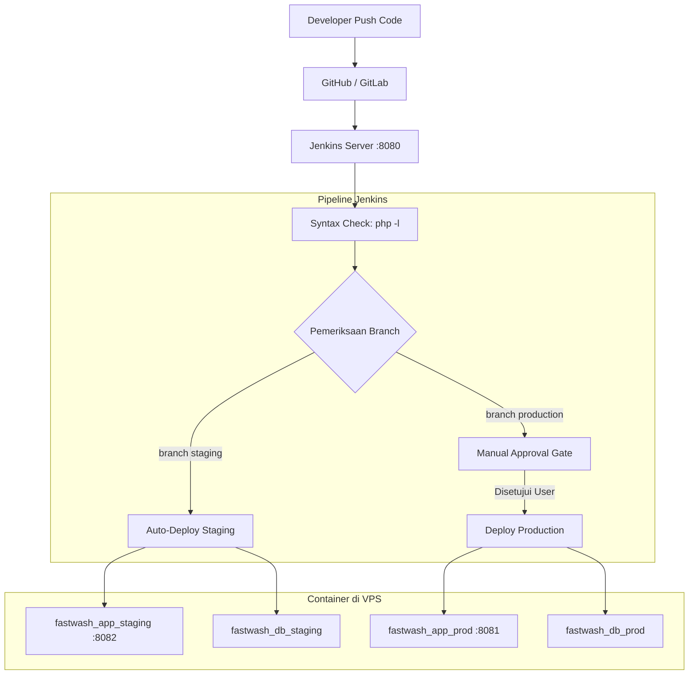

# Panduan Lengkap Setup Server, CI/CD Jenkins, dan Docker Deployment Fast Wash

Dokumen ini berisi panduan lengkap langkah demi langkah untuk melakukan setup server VPS, implementasi CI/CD dengan Jenkins, deployment multi-environment (Staging & Production) menggunakan Docker, konfigurasi reverse proxy Nginx dengan SSL, hingga integrasi subdomain di Cloudflare.

---

## Daftar Isi
1. [Arsitektur & Konsep Deployment](#1-arsitektur--konsep-deployment)
2. [Persiapan Awal Server VPS](#2-persiapan-awal-server-vps)
3. [Setup Jenkins Server (di Dalam Docker)](#3-setup-jenkins-server-di-dalam-docker)
4. [Konfigurasi Proyek Fast Wash](#4-konfigurasi-proyek-fast-wash)
5. [Konfigurasi DNS Subdomain di Cloudflare](#5-konfigurasi-dns-subdomain-di-cloudflare)
6. [Konfigurasi Nginx Reverse Proxy & SSL di VPS](#6-konfigurasi-nginx-reverse-proxy--ssl-di-vps)
7. [Konfigurasi Multibranch Pipeline di Dashboard Jenkins](#7-konfigurasi-multibranch-pipeline-di-dashboard-jenkins)

---

## 1. Arsitektur & Konsep Deployment

### Alur CI/CD


### Rincian 5 Container di VPS

| No | Nama Container | Service | Port Binding Internal | Keterangan |
| :--- | :--- | :--- | :--- | :--- |
| 1 | `jenkins_server` | Jenkins CI/CD | `8080:8080` | Mesin otomasi build & deploy |
| 2 | `fastwash_app_staging` | Web PHP Staging | `127.0.0.1:8082:80` | Aplikasi Staging (`staging.fastwash.my.id`) |
| 3 | `fastwash_db_staging` | Database Staging | Internal Docker | PostgreSQL khusus data uji coba |
| 4 | `fastwash_app_prod` | Web PHP Production | `127.0.0.1:8081:80` | Aplikasi Production (`fastwash.my.id`) |
| 5 | `fastwash_db_prod` | Database Production | Internal Docker | PostgreSQL data transaksi utama |

---

## 2. Persiapan Awal Server VPS

Panduan ini menggunakan sistem operasi **Ubuntu 22.04 / 24.04 LTS**.

### 2.1 Update Sistem & Paket Dasar
Login ke VPS via SSH, lalu jalankan:
```bash
sudo apt update && sudo apt upgrade -y
sudo apt install -y curl wget git ufw apt-transport-https ca-certificates gnupg lsb-release
```

### 2.2 Pasang Swap Memory (Sangat Disarankan untuk RAM 1-2 GB)
```bash
sudo fallocate -l 2G /swapfile
sudo chmod 600 /swapfile
sudo mkswap /swapfile
sudo swapon /swapfile
echo '/swapfile none swap sw 0 0' | sudo tee -a /etc/fstab
```

### 2.3 Install Docker Engine & Docker Compose Plugin
```bash
# Tambahkan GPG key resmi Docker
sudo install -m 0755 -d /etc/apt/keyrings
curl -fsSL https://download.docker.com/linux/ubuntu/gpg | sudo gpg --dearmor -o /etc/apt/keyrings/docker.gpg
sudo chmod a+r /etc/apt/keyrings/docker.gpg

# Daftarkan repository Docker
echo \
  "deb [arch=$(dpkg --print-architecture) signed-by=/etc/apt/keyrings/docker.gpg] https://download.docker.com/linux/ubuntu \
  $(. /etc/os-release && echo "$VERSION_CODENAME") stable" | \
  sudo tee /etc/apt/sources.list.d/docker.list > /dev/null

# Install Docker
sudo apt update
sudo apt install -y docker-ce docker-ce-cli containerd.io docker-buildx-plugin docker-compose-plugin

# Aktifkan Docker
sudo systemctl enable --now docker
```

### 2.4 Atur Firewall VPS (UFW)
```bash
sudo ufw allow OpenSSH
sudo ufw allow 80/tcp     # Web HTTP
sudo ufw allow 443/tcp    # Web HTTPS
sudo ufw allow 8080/tcp   # Jenkins UI (sementara sebelum pakai reverse proxy)
sudo ufw --force enable
sudo ufw status
```

---

## 3. Setup Jenkins Server (di Dalam Docker)

Menggunakan metode **Docker-outside-of-Docker (DooD)** agar Jenkins yang berada di dalam container dapat membuat dan mengontrol container lain di VPS.

### 3.1 Buat Direktori Kerja Jenkins
```bash
mkdir -p ~/jenkins-docker && cd ~/jenkins-docker
```

### 3.2 Buat `Dockerfile` untuk Jenkins
Buat image Jenkins turunan yang sudah memiliki CLI `docker` dan `docker compose`:
```bash
nano Dockerfile
```
Isi dengan:
```dockerfile
FROM jenkins/jenkins:lts-jdk17

USER root

# Pasang Docker CLI & Docker Compose di dalam image Jenkins
RUN apt-get update && apt-get install -y ca-certificates curl gnupg lsb-release \
    && install -m 0755 -d /etc/apt/keyrings \
    && curl -fsSL https://download.docker.com/linux/debian/gpg | gpg --dearmor -o /etc/apt/keyrings/docker.gpg \
    && chmod a+r /etc/apt/keyrings/docker.gpg \
    && echo "deb [arch=$(dpkg --print-architecture) signed-by=/etc/apt/keyrings/docker.gpg] https://download.docker.com/linux/debian $(. /etc/os-release && echo "$VERSION_CODENAME") stable" | tee /etc/apt/sources.list.d/docker.list > /dev/null \
    && apt-get update && apt-get install -y docker-ce-cli docker-compose-plugin \
    && apt-get clean && rm -rf /var/lib/apt/lists/*

USER jenkins
```

### 3.3 Buat `docker-compose.yml` untuk Jenkins
```bash
nano docker-compose.yml
```
Isi dengan:
```yaml
services:
  jenkins:
    build: .
    container_name: jenkins_server
    restart: always
    user: root  # Menggunakan root agar tidak terhambat permission docker.sock
    ports:
      - "8080:8080"
      - "50000:50000"
    volumes:
      - jenkins_data:/var/jenkins_home
      # Mount socket docker VPS ke dalam container Jenkins
      - /var/run/docker.sock:/var/run/docker.sock

volumes:
  jenkins_data:
```

### 3.4 Jalankan Jenkins
```bash
docker compose up -d --build
```

### 3.5 Ambil Password Administrator Jenkins
```bash
docker exec jenkins_server cat /var/jenkins_home/secrets/initialAdminPassword
```
Simpan password ini untuk aktivasi awal Jenkins di browser.

---

## 4. Konfigurasi Proyek Fast Wash

Seluruh konfigurasi berikut disimpan langsung di repositori proyek Anda:

### 4.1 `Dockerfile` (Aplikasi Fast Wash)
```dockerfile
FROM php:8.2-apache

# Install ekstensi dan driver PostgreSQL untuk PDO
RUN apt-get update && apt-get install -y libpq-dev \
    && docker-php-ext-install pdo pdo_pgsql \
    && apt-get clean && rm -rf /var/lib/apt/lists/*

# Aktifkan mod_rewrite Apache agar routing .htaccess berfungsi
RUN a2enmod rewrite

# Pastikan Apache mengizinkan AllowOverride All
RUN sed -i '/<Directory \/var\/www\/>/,/<\/Directory>/ s/AllowOverride None/AllowOverride All/' /etc/apache2/apache2.conf

WORKDIR /var/www/html

# Salin seluruh kode proyek ke dalam web root Apache
COPY . /var/www/html/

# Atur ownership ke www-data
RUN chown -R www-data:www-data /var/www/html

EXPOSE 80
CMD ["apache2-foreground"]
```

### 4.2 `.dockerignore`
```
.git
.gitignore
.env
.env.*
.agents
node_modules
tools
docs
*.log
docker-compose*.yml
Jenkinsfile
README.md
```

### 4.3 `docker-compose.staging.yml`
```yaml
services:
  app:
    build:
      context: .
      dockerfile: Dockerfile
    container_name: fastwash_app_staging
    restart: always
    ports:
      - "127.0.0.1:8082:80"
    environment:
      - DB_HOST=db
      - DB_PORT=5432
      - DB_NAME=fast_wash_staging
      - DB_USER=postgres
      - DB_PASS=staging_secret_pass
      - DB_SSLMODE=disable
      - APP_DEBUG=true
    depends_on:
      - db

  db:
    image: postgres:15-alpine
    container_name: fastwash_db_staging
    restart: always
    environment:
      POSTGRES_DB: fast_wash_staging
      POSTGRES_USER: postgres
      POSTGRES_PASSWORD: staging_secret_pass
    volumes:
      - pgdata_staging:/var/lib/postgresql/data
      - ./sql/01_master_dan_identitas.sql:/docker-entrypoint-initdb.d/01_master_dan_identitas.sql
      - ./sql/02_pengguna_dan_autentikasi.sql:/docker-entrypoint-initdb.d/02_pengguna_dan_autentikasi.sql
      - ./sql/03_pesanan_dan_transaksi.sql:/docker-entrypoint-initdb.d/03_pesanan_dan_transaksi.sql
      - ./sql/04_absensi_dan_log.sql:/docker-entrypoint-initdb.d/04_absensi_dan_log.sql
      - ./sql/05_indeks_dan_trigger.sql:/docker-entrypoint-initdb.d/05_indeks_dan_trigger.sql
      - ./sql/06_views_antarmuka.sql:/docker-entrypoint-initdb.d/06_views_antarmuka.sql
      - ./sql/07_data_awal_seed.sql:/docker-entrypoint-initdb.d/07_data_awal_seed.sql

volumes:
  pgdata_staging:
```

### 4.4 `docker-compose.prod.yml`
```yaml
services:
  app:
    build:
      context: .
      dockerfile: Dockerfile
    container_name: fastwash_app_prod
    restart: always
    ports:
      - "127.0.0.1:8081:80"
    environment:
      - DB_HOST=db
      - DB_PORT=5432
      - DB_NAME=fast_wash_prod
      - DB_USER=postgres
      - DB_PASS=prod_ultra_secure_pass
      - DB_SSLMODE=disable
      - APP_DEBUG=false
    depends_on:
      - db

  db:
    image: postgres:15-alpine
    container_name: fastwash_db_prod
    restart: always
    environment:
      POSTGRES_DB: fast_wash_prod
      POSTGRES_USER: postgres
      POSTGRES_PASSWORD: prod_ultra_secure_pass
    volumes:
      - pgdata_prod:/var/lib/postgresql/data
      - ./sql/01_master_dan_identitas.sql:/docker-entrypoint-initdb.d/01_master_dan_identitas.sql
      - ./sql/02_pengguna_dan_autentikasi.sql:/docker-entrypoint-initdb.d/02_pengguna_dan_autentikasi.sql
      - ./sql/03_pesanan_dan_transaksi.sql:/docker-entrypoint-initdb.d/03_pesanan_dan_transaksi.sql
      - ./sql/04_absensi_dan_log.sql:/docker-entrypoint-initdb.d/04_absensi_dan_log.sql
      - ./sql/05_indeks_dan_trigger.sql:/docker-entrypoint-initdb.d/05_indeks_dan_trigger.sql
      - ./sql/06_views_antarmuka.sql:/docker-entrypoint-initdb.d/06_views_antarmuka.sql
      - ./sql/07_data_awal_seed.sql:/docker-entrypoint-initdb.d/07_data_awal_seed.sql

volumes:
  pgdata_prod:
```

### 4.5 `Jenkinsfile` (Pipeline dengan Manual Approval di Production)
```groovy
pipeline {
    agent any

    stages {
        stage('Checkout') {
            steps {
                checkout scm
            }
        }

        stage('Syntax Check (Lint)') {
            steps {
                echo "Memeriksa sintaks seluruh file PHP..."
                sh '''
                    find . -type f -name "*.php" -not -path "./vendor/*" -exec php -l {} \\;
                '''
            }
        }

        stage('Deploy to Staging') {
            when {
                branch 'staging'
            }
            steps {
                echo "Branch staging terdeteksi! Melakukan deployment ke environment Staging..."
                sh '''
                    docker compose -f docker-compose.staging.yml -p fastwash-staging down
                    docker compose -f docker-compose.staging.yml -p fastwash-staging up -d --build
                '''
            }
        }

        stage('Deploy to Production') {
            when {
                branch 'production'
            }
            steps {
                // Menunggu persetujuan / konfirmasi manual dari user di UI Jenkins
                input message: 'Apakah Anda yakin ingin mendeploy ke server PRODUCTION (fastwash.my.id)?', ok: 'Ya, Deploy ke Production'

                echo "Approval diterima! Melakukan deployment ke environment Production..."
                sh '''
                    docker compose -f docker-compose.prod.yml -p fastwash-prod down
                    docker compose -f docker-compose.prod.yml -p fastwash-prod up -d --build
                '''
            }
        }
    }

    post {
        success {
            script {
                if (env.BRANCH_NAME == 'staging') {
                    echo "SUCCESS: Staging berhasil di-deploy! Akses: http://staging.fastwash.my.id"
                } else if (env.BRANCH_NAME == 'production') {
                    echo "SUCCESS: Production berhasil di-deploy! Akses: http://fastwash.my.id"
                } else {
                    echo "SUCCESS: Build & test berhasil untuk branch ${env.BRANCH_NAME} (tidak ada deployment)."
                }
            }
        }
        failure {
            echo "FAILED: Terjadi kesalahan saat build atau deployment. Cek console log Jenkins!"
        }
    }
}
```

---

## 5. Konfigurasi DNS Subdomain di Cloudflare

Untuk mengarahkan domain ke VPS, buka [dash.cloudflare.com](https://dash.cloudflare.com/), pilih domain Anda (misal `gapunyaide.web.id` atau `fastwash.my.id`), lalu masuk ke menu **DNS** &rarr; **Records**.

Tambahkan **A Record** berikut:

| Type | Name | Content / IPv4 Address | Proxy Status | Keterangan |
| :--- | :--- | :--- | :--- | :--- |
| **A** | `@` | `IP_VPS_ANDA` | DNS only (awal) | Domain Production utama |
| **A** | `staging` | `IP_VPS_ANDA` | DNS only (awal) | Subdomain Staging |
| **A** | `jenkins` | `IP_VPS_ANDA` | DNS only (awal) | Subdomain Akses Dashboard Jenkins |

> [!NOTE]
> Pilih status **DNS only (awan abu-abu)** terlebih dahulu agar proses pembuatan SSL Let's Encrypt (Certbot) di VPS berjalan lancar tanpa terhalang proxy Cloudflare. Setelah SSL aktif, Anda bebas menyalakan mode **Proxied (awan oranye)**.

---

## 6. Konfigurasi Nginx Reverse Proxy & SSL di VPS

### 6.1 Install Nginx & Certbot
```bash
sudo apt update
sudo apt install -y nginx certbot python3-certbot-nginx
```

### 6.2 Konfigurasi Virtual Host

#### A. Production (`fastwash.my.id` &rarr; Container Port 8081)
```bash
sudo nano /etc/nginx/sites-available/fastwash.my.id
```
Isi:
```nginx
server {
    listen 80;
    server_name fastwash.my.id www.fastwash.my.id;

    location / {
        proxy_pass http://127.0.0.1:8081;
        proxy_set_header Host $host;
        proxy_set_header X-Real-IP $remote_addr;
        proxy_set_header X-Forwarded-For $proxy_add_x_forwarded_for;
        proxy_set_header X-Forwarded-Proto $scheme;
    }
}
```

#### B. Staging (`staging.fastwash.my.id` &rarr; Container Port 8082)
```bash
sudo nano /etc/nginx/sites-available/staging.fastwash.my.id
```
Isi:
```nginx
server {
    listen 80;
    server_name staging.fastwash.my.id;

    location / {
        proxy_pass http://127.0.0.1:8082;
        proxy_set_header Host $host;
        proxy_set_header X-Real-IP $remote_addr;
        proxy_set_header X-Forwarded-For $proxy_add_x_forwarded_for;
        proxy_set_header X-Forwarded-Proto $scheme;
    }
}
```

#### C. Jenkins (`jenkins.gapunyaide.web.id` &rarr; Jenkins Port 8080)
```bash
sudo nano /etc/nginx/sites-available/jenkins.gapunyaide.web.id
```
Isi:
```nginx
server {
    listen 80;
    server_name jenkins.gapunyaide.web.id;

    location / {
        proxy_pass http://127.0.0.1:8080;
        proxy_set_header Host $host;
        proxy_set_header X-Real-IP $remote_addr;
        proxy_set_header X-Forwarded-For $proxy_add_x_forwarded_for;
        proxy_set_header X-Forwarded-Proto $scheme;

        # Mendukung WebSocket Jenkins
        proxy_http_version 1.1;
        proxy_set_header Upgrade $http_upgrade;
        proxy_set_header Connection "upgrade";
    }
}
```

### 6.3 Aktifkan Virtual Host & Reload Nginx
```bash
sudo ln -s /etc/nginx/sites-available/fastwash.my.id /etc/nginx/sites-enabled/
sudo ln -s /etc/nginx/sites-available/staging.fastwash.my.id /etc/nginx/sites-enabled/
sudo ln -s /etc/nginx/sites-available/jenkins.gapunyaide.web.id /etc/nginx/sites-enabled/

# Uji konfigurasi Nginx
sudo nginx -t

# Reload Nginx
sudo systemctl reload nginx
```

### 6.4 Pasang Sertifikat SSL Gratis (HTTPS)
Jalankan satu perintah ini untuk mengamankan seluruh domain:
```bash
sudo certbot --nginx -d fastwash.my.id -d www.fastwash.my.id -d staging.fastwash.my.id -d jenkins.gapunyaide.web.id
```

---

## 7. Konfigurasi Multibranch Pipeline di Dashboard Jenkins

1. Buka browser dan akses Jenkins melalui domain baru: `https://jenkins.gapunyaide.web.id`.
2. Masukkan password administrator awal yang didapat dari perintah:
   ```bash
   docker exec jenkins_server cat /var/jenkins_home/secrets/initialAdminPassword
   ```
3. Pilih **Install suggested plugins**, tunggu hingga selesai, lalu buat akun admin baru.
4. Di Dashboard Jenkins, klik **New Item**:
   * Nama Item: `fast-wash`
   * Tipe: Pilih **Multibranch Pipeline** &rarr; Klik **OK**.
5. Pada bagian **Branch Sources**:
   * Klik **Add source** &rarr; Pilih **Git**.
   * Masukkan URL repositori GitHub/GitLab Anda.
   * Tambahkan Credentials (menggunakan GitHub Personal Access Token atau SSH Key).
6. Pada bagian **Build Configuration**:
   * Mode: *by Jenkinsfile* (Script Path: `Jenkinsfile`).
7. Pada bagian **Scan Multibranch Pipeline Triggers**:
   * Centang *Periodically if not otherwise run* (misal: selang 5 menit atau 1 jam).
8. Klik **Save**.

### Verifikasi Hasil:
* Saat Anda melakukan `git push origin staging`, Jenkins otomatis mendeteksi branch `staging` dan mendeploy ke `https://staging.fastwash.my.id`.
* Saat Anda melakukan `git push origin production`, Jenkins akan menjalankan pengujian sintaks, lalu **berhenti dan memunculkan tombol konfirmasi approval**. Setelah Anda klik **"Ya, Deploy ke Production"**, aplikasi baru akan rilis ke `https://fastwash.my.id`.
